# Nmap and Reconnaissance Lab

Hands-on network scanning and reconnaissance tasks completed during my Certificate Course on Cyber Security at NIELIT Calicut (19 Mar to 1 May 2025, 120 hours, online).

**Tools:** Nmap, Dmitry, Netcat, nslookup, whois, ping (Kali Linux, TryHackMe lab network)

**What I practiced**
- Host discovery across a /24 range (`nmap -sn`)
- Scanning specific ports, port ranges and the most popular ports
- Detecting open ports and service/version information (`-sV`)
- Excluding hosts from a scan
- Domain reconnaissance with Dmitry (subdomains, whois, TCP port scan, email search), nslookup and whois
- Netcat for file transfer and remote shell

**Note:** The screenshots show the real output from each run. In this lab environment some results were empty or blocked (all ports filtered on the target, no subdomains or emails found for the example domain, Netcat connection refused).

Only scan systems you own or are authorised to test.

## Task log

---

1\. Scan and show the entire IP range using nmap.

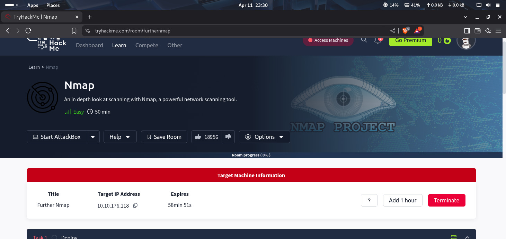

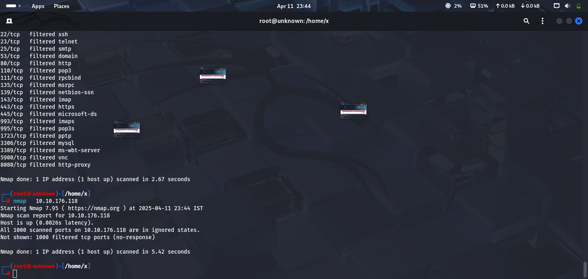

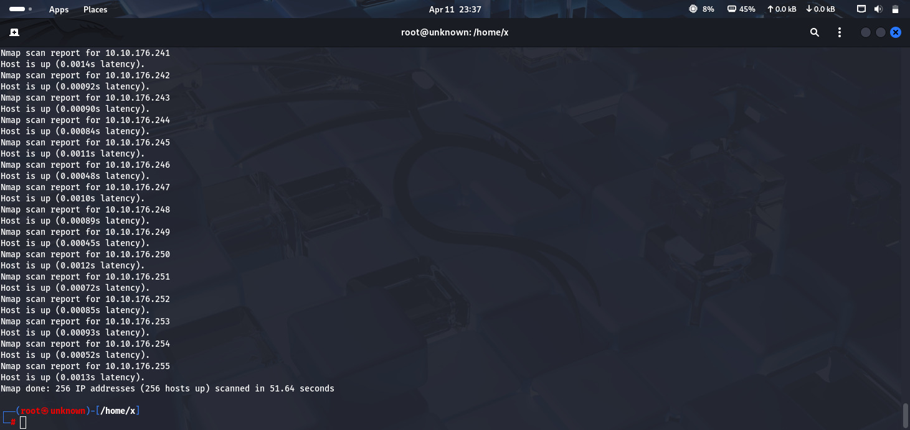

2\. Showcase how to scan a specific port or entire port range using nmap.

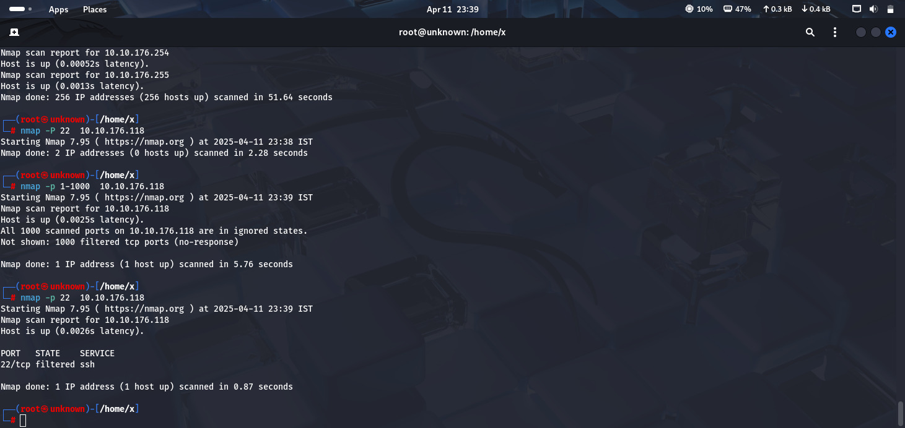

3\. Scan and show active Host using nmap.

Nmap -sn 10.10.176.0./24  
  
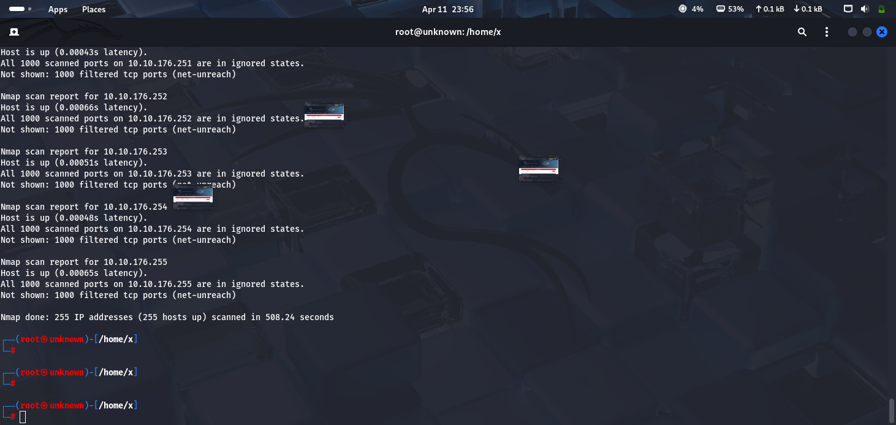

4\. How to scan the fixed number of most popular ports using nmap.

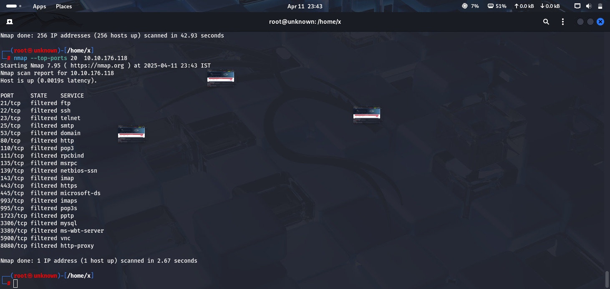

5\. How to detect open ports using nmap.

6\. Do a scan using nmap by excluding the host/IP addresses.

7\. How to detect services and its version running in your machine using nmap.

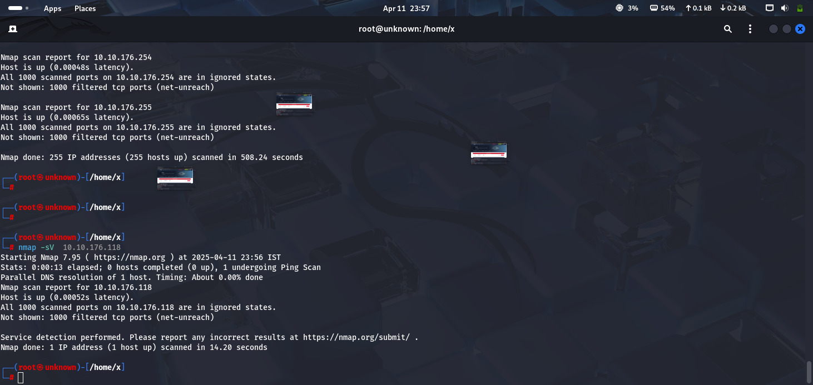

8\. Search for possible subdomains of any domain (e.g., www.indeed.com) using Dmitry tool.

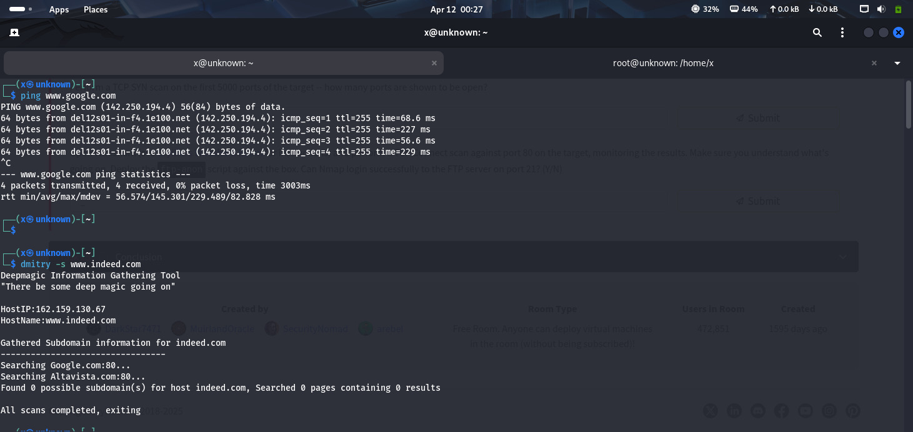

9\. Perform a whois lookup on any domain (e.g., www.indeed.com) using Dmitry tool.

10\. Using Dmitry tool, perform a TCP port scan on any host.

11\. Using Dmitry tool, perform a search for possible email addresses on any domain.

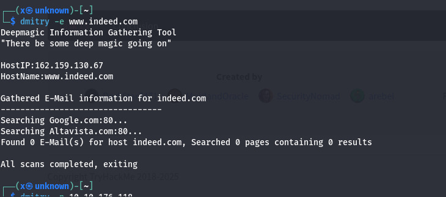

12\. Using Netcat, copy the content of a confidential file from one machine to another machine.

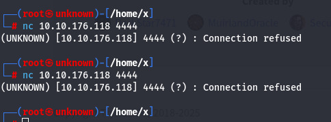

13\. Using Netcat, take shell control of one machine from another machine.

14\. Using nslookup & whois, gather the info of a domain (e.g., www.indeed.com).

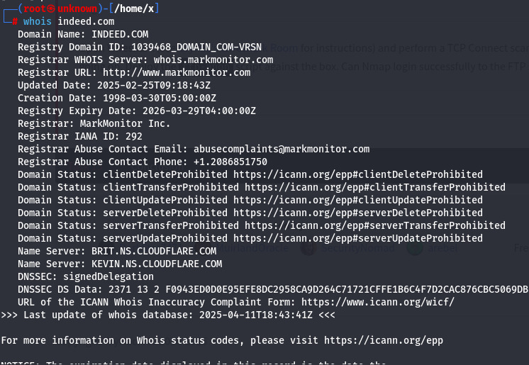  
  
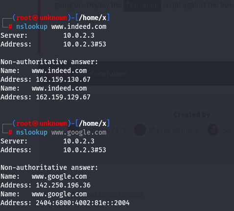

