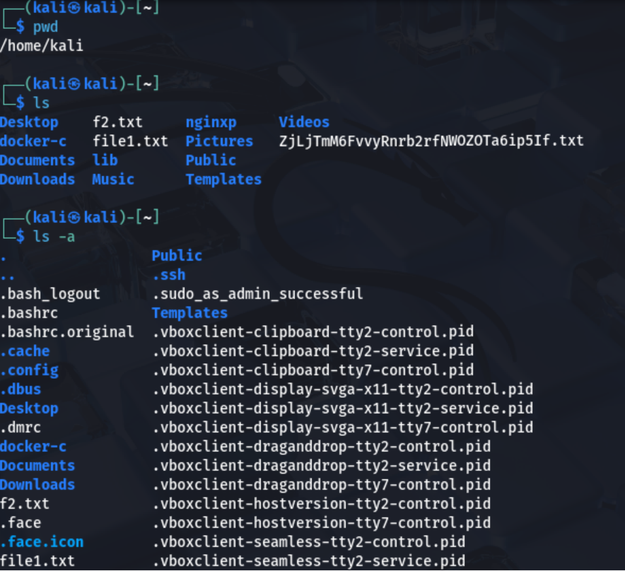
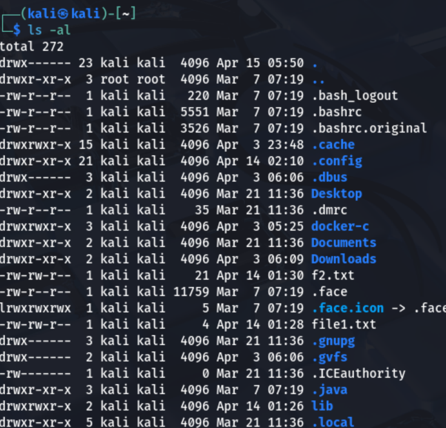
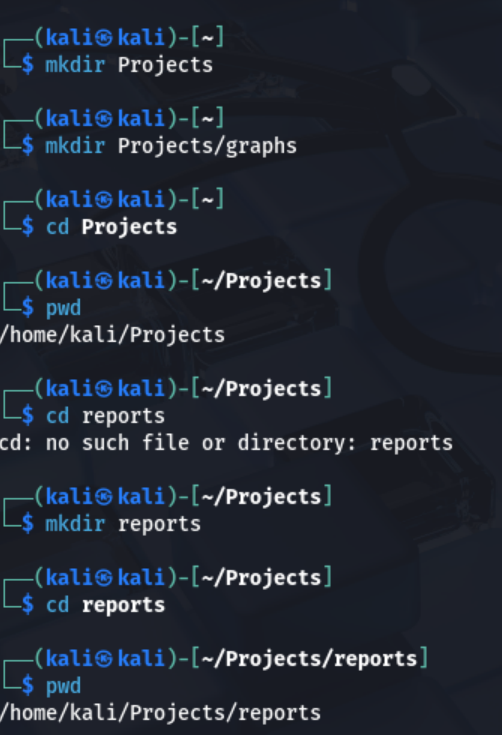
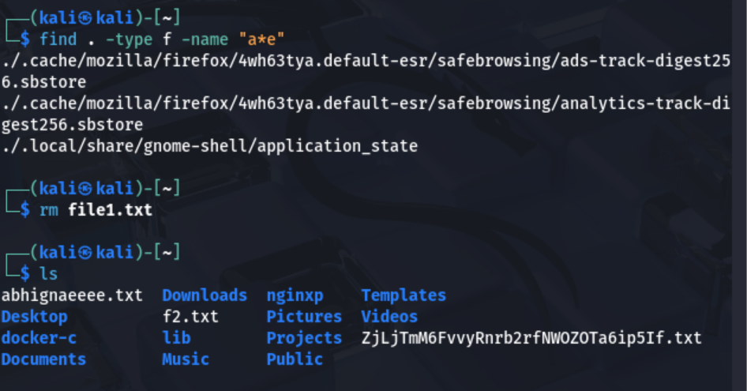
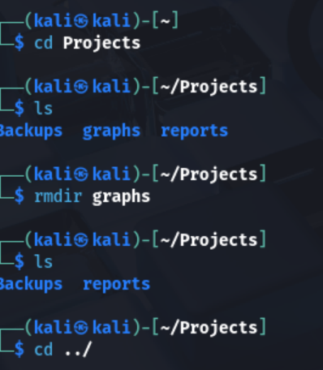
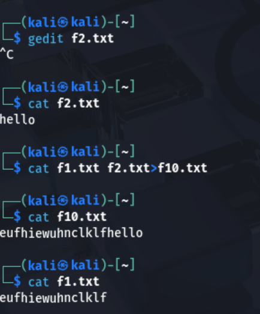

# Linux Command-Line Basics Lab

Introductory Linux exercises completed during my NIELIT Calicut cybersecurity internship.

**Covered:** navigating the filesystem (`pwd`, `cd`, `ls -a`, `ls -al`), creating and removing files and directories (`mkdir`, `rm`, `rmdir`), wildcards (`ls *.txt`), viewing and merging file contents, and command history.

## Exercise log

---

1.  Log in to Linux with your username and password.

2.  

3.  If you are in a graphical desktop, take a terminal

4.  In the terminal, you should be in your home directory. Verify this using the “print working directory” command

> pwd
>
> /home/user1

the answer is in the above picture.

5.  Check if you have any files in your home directory using each of the following commands.

> ls
>
> ls -a ls -al
>
> 
>
> 
>
> Why do the first and second command return different number of files?
>
> It gives different kind of output
>
> What is the size of the largest file and the largest directory currently in your home directory as reported by the third command?
>
> cache

6.  Use the ls command to examine the results of the previous command. You should find that it created the following 3 new, empty files in the home directory.

> ls

7.  Use mkdir to create a few directories. As you change directories, be sure to check that your working directory is as expected.

> mkdir Projects
>
> mkdir Projects/graphs cd Projects
>
> pwd
>
> cd reports pwd
>
> mkdir ../Backups
>
> Use ls to examine your work:
>
> cd ls -l
>
> ls Projects

8.  List txt files only

> ls \*.txt

9.  List files starting with ‘a’ and ending with ‘e’

10. 

11. Remove the one file:

> rm file1 ls

12. Delete graphs directory

> rmdir graphs
>
> 

13. How to View the Contents of any File without opening it?

14. How to view the list of Commands executed?

15. Show how to create multiple directory in a single instance ?

16. 

17. Merge the contents of file1.txt, file2.txt, file3.txt to file4.txt ?

18. 

