# Windows Server and Active Directory Lab

A small Windows domain environment built in VirtualBox during my NIELIT Calicut cybersecurity internship.

**Built**
- Windows Server 2022 and Windows 11 virtual machines on a host-only network
- Static IP for the server (192.168.56.10) with the client pointed at it for DNS
- Active Directory Domain Services with a new domain (`mydomain.local`)
- Two domain users (user1, user2)
- Group Policy Objects, including one that disables Control Panel access
- DHCP service on the server, with the Windows 11 client obtaining a lease

**Why it matters for security:** Active Directory, Group Policy and DHCP are the core of most corporate Windows networks, so they are what attackers target and defenders monitor.

## Setup log

---

**<u>1. Create Microsoft Server and Windows 11 VMs on VirtualBox</u>**

# 1. Virtual Machine Setup

• Downloaded and installed Windows Server and Windows 11 on VirtualBox.

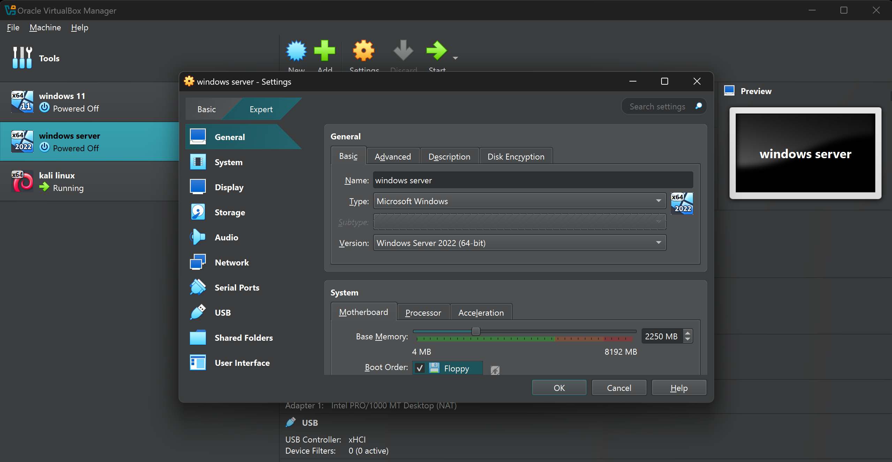

• Configured both to use Host-only network adapter.

# 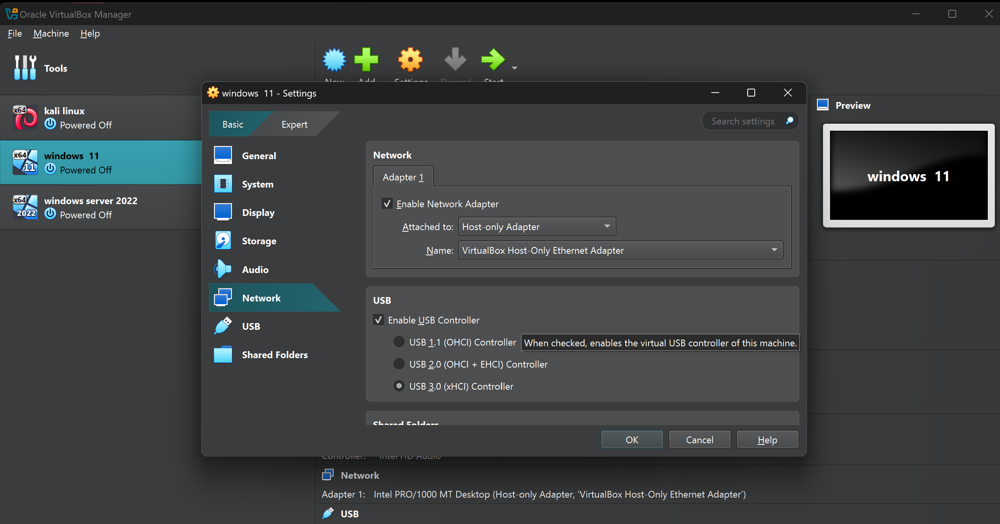

# 

# <u>2. Set Static IP on Server and Use Host-only Network</u>

# 2. Static IP Configuration

• Set static IP for Windows Server: 192.168.56.10

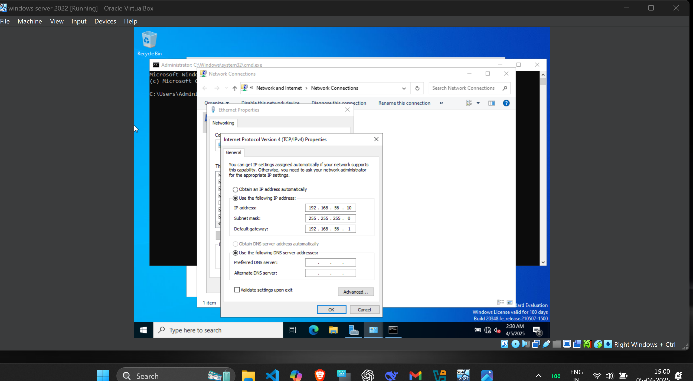

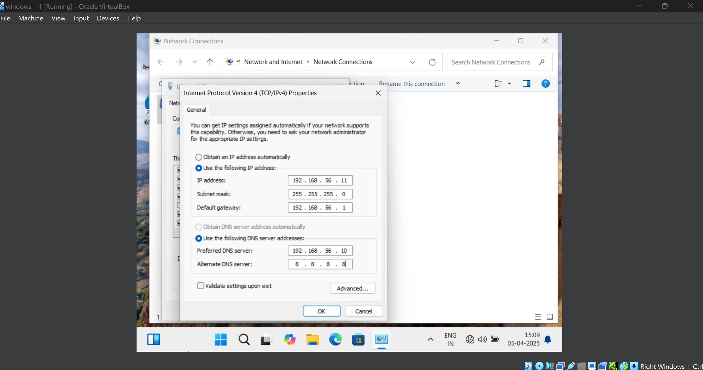

**<u>3. Configure Domain Controller in Your Server</u>**

3\. Domain Configuration (AD DS)

• Installed Active Directory Domain Services (AD DS) on Windows Server.

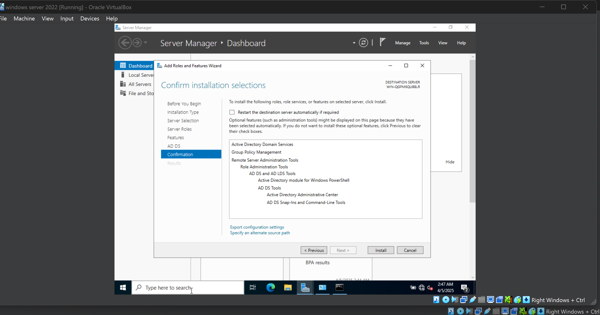

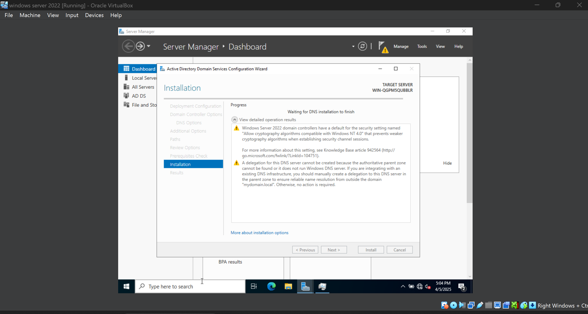

MyDomain.local

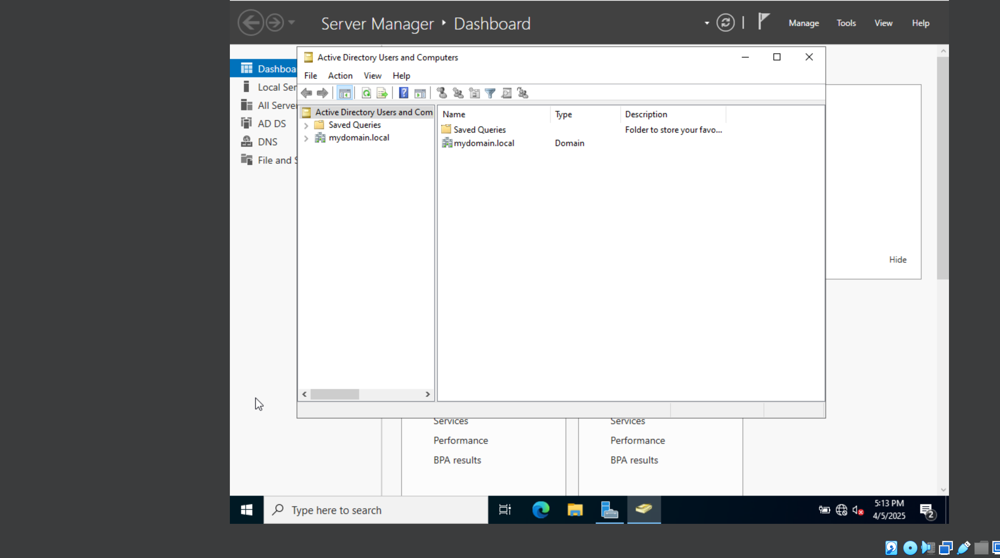

**<u>4. Create Two Domain Users and Group Policies</u>**

6\. Domain Users Creation

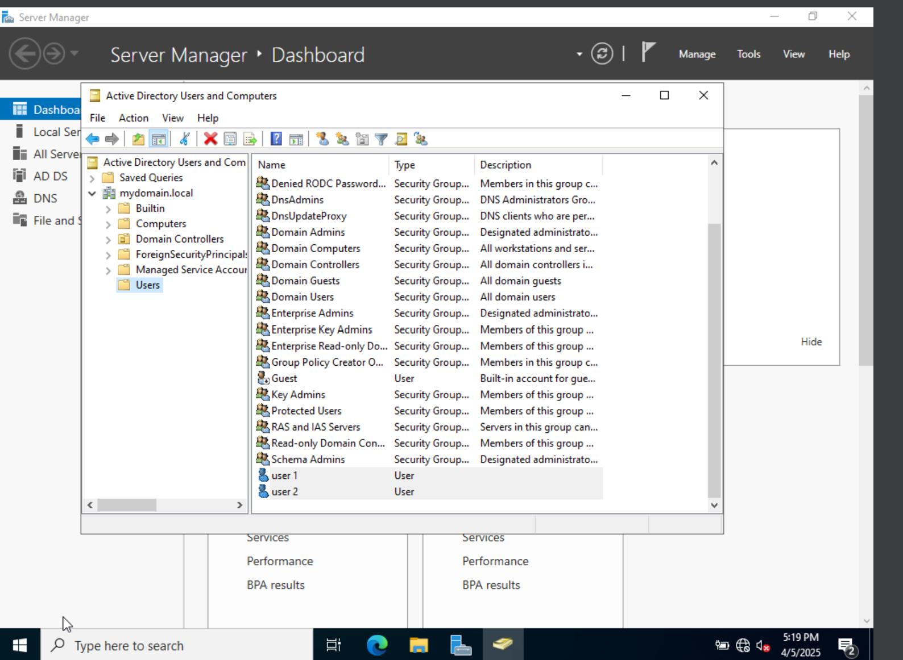

# 7. Group Policy Objects (GPO)

• Created GPO1 to disable Control Panel access.

• Created GPO2

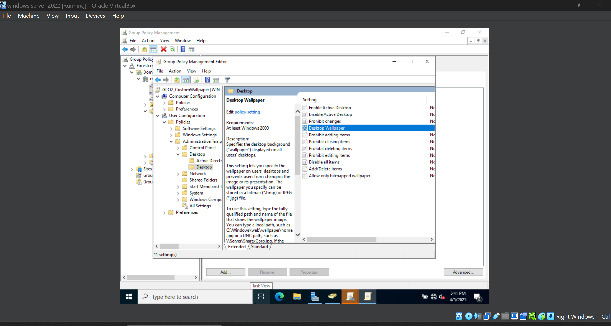

**<u>5. Configure DHCP Service on Server</u>**

**8. Dhcp**

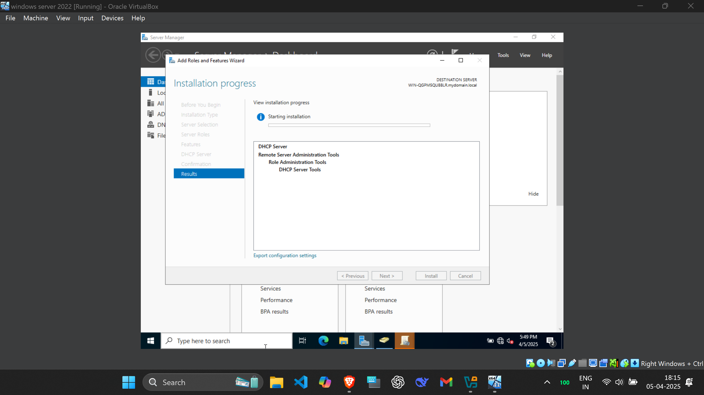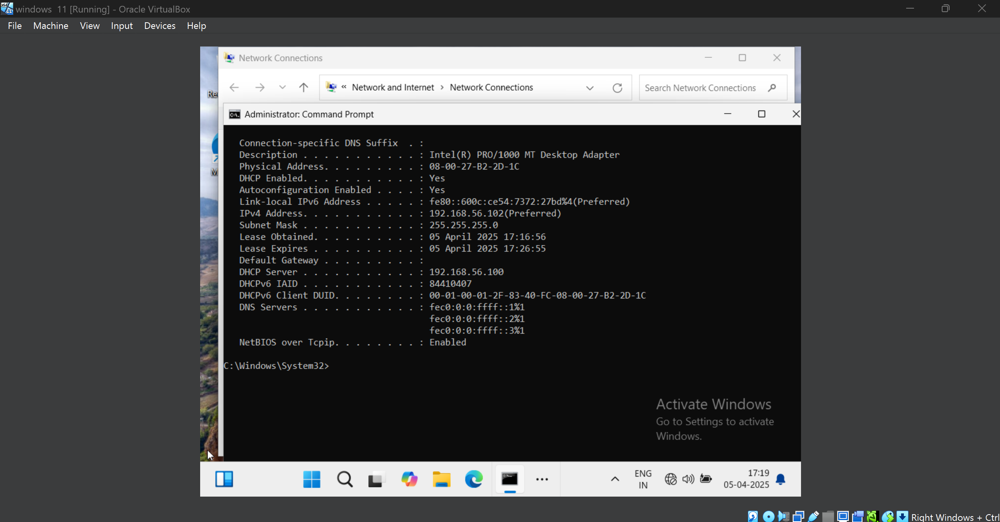

**Conclusion**

All components were successfully configured and tested.

